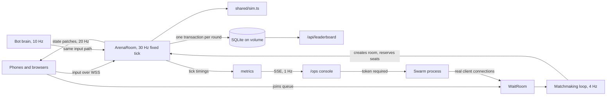

# Architecture

A browser arena game for 2 to 6 players, with 60-second rounds, built like a small live service. The server owns all game state. Clients send input and render what they are told.

## How a round works

1. A client joins `WaitRoom`, and the server gives it a generated handle.
2. Every 250 ms the matchmaking loop looks for a ready group: 6 waiting, or someone has waited 5 seconds.
3. The loop creates a private `ArenaRoom`, reserves a seat per player, and sends each client its reservation.
4. The room tops up timed-out groups with bots, then runs countdown, 60 seconds of play, and results.
5. The results are written to SQLite in one transaction, and the room closes.

## Decisions worth explaining

**One rule set for humans and bots.** Bots produce an ordinary `PlayerInput` that passes through the same `applyInput`, so they cannot do anything a person cannot. `shared/sim.ts` has no network imports, so it can be tested alone.

**Server authority without client prediction.** Inputs are clamped by the Colyseus sanitizer and again in the sim. NaN, oversized values and fast cooldown abuse have no effect. Prediction was left out on purpose: short rounds and interpolation hide the latency, and the risk was not worth it.

**A small custom queue.** The queue is about 100 lines and exposes depth and wait times directly on the console. Load-test clients have their own pool and never land in a room with people.

**The swarm runs in a separate process.** Inside the server it would share the event loop with the game and distort the numbers it is measuring. It uses the real client SDK and the real queue, so it exercises matchmaking too.

**Two timing metrics.** Sim tick time excludes state encoding and network work. Event loop delay includes them. Quoting tick time alone would flatter the server.

**Database writes happen outside the tick.** They run on the next turn of the event loop, and their time is tracked separately.

**Whole-pixel positions.** Positions sync as 16-bit integers, because interpolation does not need more precision and it shrinks every patch.

## Reliability

- A dropped player keeps their seat for 10 seconds and then rejoins the same session.
- A player who leaves still counts in the final standings, and ties share the win.
- A failed match start returns players to the queue.
- A server that cannot bind its port exits, so the host restarts it.
- `/ops` is public to read. Starting a swarm needs a token, and swarms are capped and stop themselves after 2 minutes.

## Measured load

Measured in the production Docker image on Linux and Node 22, on an 8-core machine with the swarm in the same container and no real network between clients and server. Run again on Railway before quoting these numbers, because hosted CPU allocation and real networks will differ.

| Clients | Rooms | Tick p95 | Event loop p95 | Ticks over budget | Memory |
|---|---|---|---|---|---|
| 25 swarm + 3 bots | 5 | 0.61 ms | 6.2 ms | 0 | 137 MB |
| 150 swarm | 25 | 0.33 ms | 7.0 ms | 0 | 165 MB |
| 300 swarm | 50 | 0.30 ms | 11.0 ms | 0 | 160 MB |
| 600 swarm | 100 | 0.13 ms | 6.9 ms | 0 | 168 MB |
| 1,200 swarm | 200 | 0.07 ms | 24.1 ms | 0 of 413,949 | 183 MB |

The tick budget at 30 Hz is 33.3 ms. The 1,200 run was the highest tested, not a proven ceiling. The event loop delay starting to climb there is the first sign of pressure. Tick p95 falls at higher counts partly because rooms in the rolling window are at different phases, so read it alongside event loop delay.

## Hostile clients

`scripts/abuse.ts` runs as a test against a live server. Before the fixes it broke in: any client could create an arena with an invented identity, and input floods were never stopped.

- Arenas only accept rooms and seats carrying a per-process key that clients never see.
- Clients over 120 messages a second are disconnected.
- Input values are clamped twice, and NaN or infinite values have no effect.
- Queue joins write nothing to the database, so random ids cannot grow it.
- Metrics are built once a second on a timer, so requests cannot trigger the work.
- An exception inside a room closes that room only. With faults injected into 16 rooms, the server stayed up and every client requeued.

## Limits and next steps

This runs as a single process, because a Railway volume attaches to one instance. To scale out, move presence and matchmaking state to the Colyseus Redis packages, and replace SQLite with Postgres.

The queue is first come, first served, with no skill rating. Player identity is a client-held UUID, which is good enough for a jam leaderboard but spoofable.
